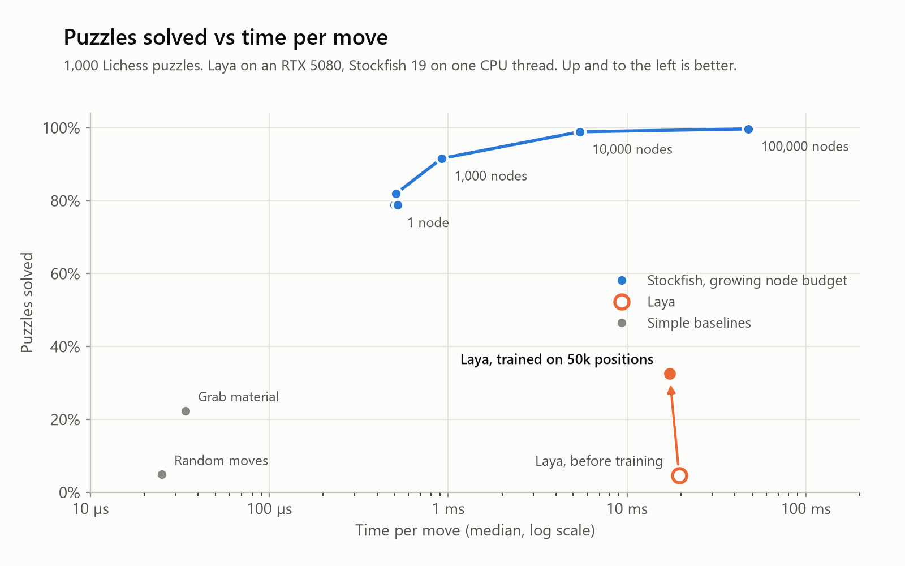
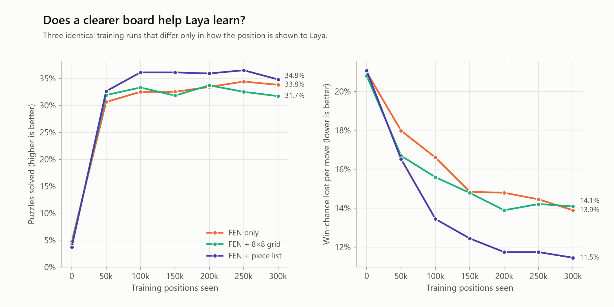
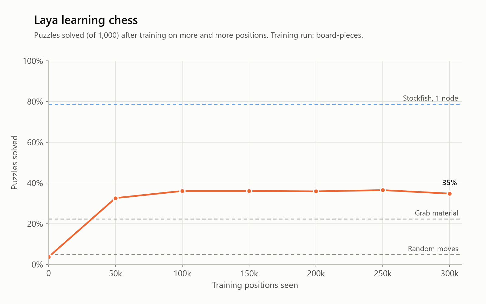
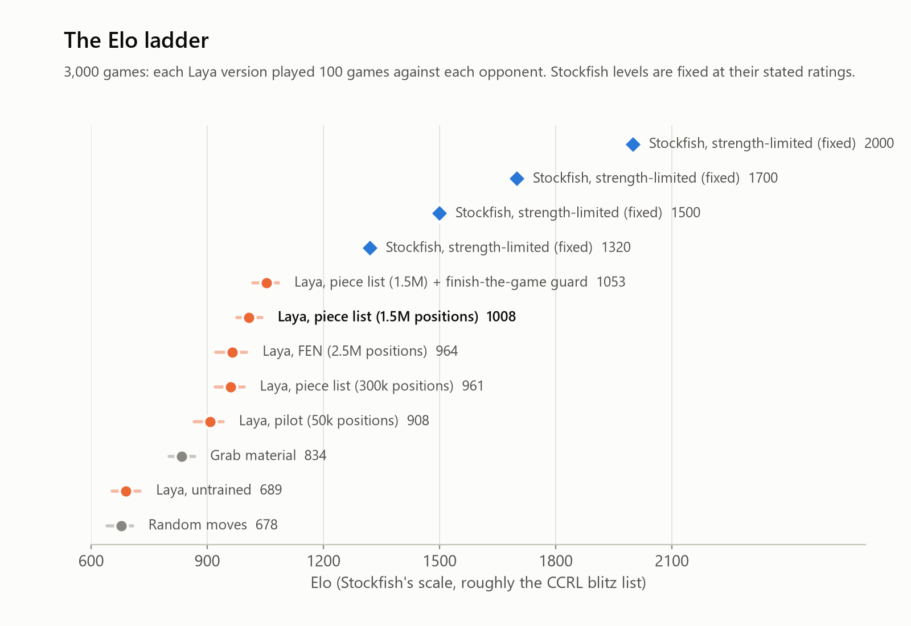

# system1-chess-laya

Can a small "System-1" decision model play chess, and how fast?

[Laya](https://huggingface.co/convaiinnovations/laya) is an open-weight model (421M parameters) that picks an
answer from a list of options in a single step, without thinking ahead. This project runs it locally, asks it to
choose chess moves, and measures how good and how fast those moves are compared with Stockfish. First as it comes,
then after training it on chess.

> **Status:** Phase 4 done (games and Elo). See the
> [roadmap](docs/roadmap.md).

## First results

Tested on 1,000 Lichess puzzles and 2,000 positions from real games ([details](testsets/README.md)).

| Engine | Puzzles solved | Win-chance lost per move (games) | Time per move (median) |
|---|---:|---:|---:|
| Random moves | 4.9% | 21.3% | 26 µs |
| Stockfish, 1 node | 78.8% | 2.5% | 0.6 ms |
| Stockfish, 10,000 nodes | 98.9% | 0.7% | 6.6 ms |
| Laya, before any training | 4.7% | 21.1% | 19.4 ms (GPU) |
| Laya, after a 10-minute pilot (50k positions) | 32.6% | 16.2% | 17.3 ms (GPU) |
| Laya, after an overnight run (2.5M positions) | 35.3% | 12.9% | 15.3 ms (GPU) |
| Laya with a piece list, 300k positions | 34.8% | 11.5% | 17.2 ms (GPU) |
| **Laya with a piece list, 1.5M positions** | **35.8%** | **10.9%** | 14.9 ms (GPU) |

<picture>
  <source media="(prefers-color-scheme: dark)" srcset="figures/strength_vs_time-dark.png">
  
</picture>

Out of the box, Laya plays no better than random. After training on 50,000 positions analysed by Stockfish, it already
beats a "grab material" player. Training overnight on 2.5 million positions improved it further, but slowly.

**How the board is shown matters more than how much data Laya sees.** Laya reads text, and a FEN string such as
`r1bqkb1r/pppp1ppp/2n2n2` reaches it as fragments like `rk`, `pp`, `1`, so it has to count its way to each piece.
Adding a list of each side's pieces, written like the moves (`Ke1 Qd1 Nf3`), let a 300k-position run beat the 2.5M
FEN run on move quality. An 8×8 grid of the same length made no difference. A longer run with the piece list (1.5M
positions) gave the best model so far, but only by a little: with this setup Laya levels off at about 36% of puzzles.

<picture>
  <source media="(prefers-color-scheme: dark)" srcset="figures/board_formats-dark.png">
  
</picture>

<picture>
  <source media="(prefers-color-scheme: dark)" srcset="figures/learning_curve-dark.png">
  
</picture>

## Elo from 3,000 games

Each Laya version played 100 games against each opponent: a random mover, a "grab material" player, and Stockfish
limited to 1320, 1500, 1700 and 2000 Elo. All games start from 50 balanced openings, each played with both colours.

<picture>
  <source media="(prefers-color-scheme: dark)" srcset="figures/elo_ladder-dark.png">
  
</picture>

Training took Laya from the level of a random mover (689) to about **1010 Elo**, ahead of "grab material" (834) but
still well below Stockfish's weakest setting (1320), against which it scored 11.5 out of 100. The ranking matches
the test-set results. The numbers are on Stockfish's scale (roughly the CCRL computer rating list), not a human one.

**Laya wins material but can't finish games.** Against the random mover, the best Laya won 74 games and drew 26, and
in every one of those 26 draws it was at least a rook ahead. It walks into threefold repetitions and stalemates
because it only ever sees the current position, not how the game got there. A simple guard (when clearly ahead, skip
moves that repeat a position or stalemate) fixes that: 99.5 out of 100 against the random mover, and **1053 Elo**.
It changes nothing against Stockfish, where Laya is rarely ahead.

**Hardware:** Laya needs about 2.3 GB of GPU memory. On an RTX 5080 it takes about 18 ms per move, or about
5 ms per position when positions are processed in batches. On a CPU (Ryzen 9 9900X) it takes about 280 ms per move.
Details in the [roadmap](docs/roadmap.md#what-phase-2-showed).

## Quick start

You need [uv](https://docs.astral.sh/uv/). An NVIDIA GPU is recommended but not required.

```bash
uv sync
uv run python scripts/smoke_test.py          # Laya picks moves on a few positions
uv run python scripts/evaluate.py laya       # full test: puzzles and game positions
uv run python scripts/results_table.py       # results so far
uv run python scripts/make_charts.py         # redraw the charts in figures/
uv run python scripts/play_matches.py        # games against Stockfish and baselines, then Elo (~2 h)
```

To train Laya yourself, see [docs/training.md](docs/training.md).

The first run downloads the Laya model (about 1.7 GB). Stockfish is needed for Stockfish runs, see
[engines/README.md](engines/README.md).

## License

MIT, see [LICENSE](LICENSE). Laya itself is Apache-2.0, by Convai Innovations.
