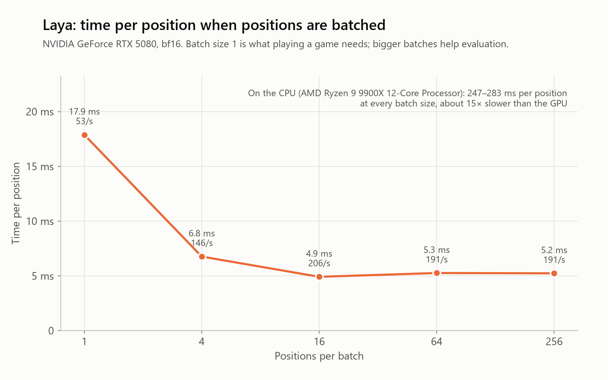

# Roadmap

The working plan. Decisions are added at the bottom as we make them.

## Questions we want to answer

| # | Question | Phase |
|---|---|---|
| 1 | How well does Laya choose chess moves out of the box? | 2 |
| 2 | How much better does it get after training on chess? | 3 |
| 3 | How strong is it for the time it takes, compared with Stockfish and Leela (no search)? | 4 |
| 4 | Does it help to let Laya play when it's confident, and hand over to Stockfish when it isn't? | 5 |

## How we'll get there

**Log everything, draw later.** Every test and game saves a record for each move: the position, the move played,
how long it took, how confident the model was, what Stockfish would have played, and how much the move cost.
All charts, the Elo chart and the demo video are made from these records, so we can redraw anything and replay
any game at any speed.

**The Elo ladder.** We measure Laya's Elo at every milestone against the same fixed group of opponents:

```
random moves → Laya out of the box → Laya after training (several checkpoints) → Laya + Stockfish fallback
```

The opponents have to cover the whole range, from a random mover up to full-strength Stockfish, and they never
change. That way the numbers stay comparable from one milestone to the next.

## Phases

| Phase | What we do | What you get at the end |
|---|---|---|
| 0. Setup | Environment, Laya and Stockfish wrappers, first test | Laya picks a move and we see how long it took |
| 1. Test harness | Test positions, metrics, the per-move record format | A results table for random play and Stockfish |
| 2. Speed and hardware | Speed on GPU and CPU, batching, chart style (shortened, since Phase 1 already answered question 1) | First charts |
| 3. Training | Build a dataset, train, calibrate, evaluate | Trained checkpoints and the Elo ladder going up |
| 4. Strength vs time | Engine matches, question 3 | The main chart: Elo vs milliseconds per move |
| 5. Fallback | Question 4, try different confidence thresholds | Elo vs average time per move |
| 6. Presentation | README, charts, demo video | A finished repo |

Each phase adds its step to the Elo ladder and its games to the replay pool, so Phase 6 is mostly putting things
together.

## Decisions

- **2026-10-01:** Keep all four questions.
- **2026-10-01:** Ask Laya with one multiple-choice question: the position is the input, every legal move is an
  option ("Option A"). Revisit during Phase 3, once Laya knows some chess.
- **2026-10-01:** Visuals matter as much as the numbers: an Elo ladder across milestones and a replay video
  showing speed and Elo.
- **2026-10-01:** Write moves as `Nf3` (SAN), not `g1f3` (UCI). Laya gives each option only about 4 tokens, and
  UCI moves start to look identical to it. In one position, 43 legal moves became only 25 the model could tell
  apart. With SAN, 47 of 48 stayed distinct.
- **2026-10-01:** Test sets: 1,000 Lichess puzzles (125 per rating band) and 2,000 positions from real Lichess games.
  Committed to the repo, never used for training. See [testsets/README.md](../testsets/README.md).
- **2026-10-01:** Answer key: Stockfish 19 evaluates every legal move of every test position (300,000 nodes each).
  Grading any engine is then a lookup, which will make checking training checkpoints fast.
- **2026-10-01:** Phase 2 shortened to speed and hardware only, since Laya out of the box plays like random.
- **2026-10-01:** Demo video: a web replay page built from the per-move records, recorded to video. The same page
  can run live on GitHub Pages.
- **2026-10-01:** Training data: the [Lichess evaluation database](https://database.lichess.org/#evals) (deep
  Stockfish analysis, CC0), streamed so only the slice we use is downloaded. Test-set positions are removed.
- **2026-10-01:** Training targets: soft targets. Where several moves are evaluated, the target is spread over them
  by how good each one is; otherwise it's the best move.
- **2026-10-01:** Training recipe: Laya's official one (soft-target loss + RLCD + re-calibration on held-out data).
- **2026-10-01:** Training budget: a short pilot, then a ~4-5 hour run, then overnight runs while Laya keeps improving.
- **2026-10-01:** Training settings: batches of 32 with gradient checkpointing, 2 batches per optimizer step. Batches
  of 24 or more without checkpointing overflow the 16 GB GPU, and Windows then silently uses system RAM, which made
  training 2.5x slower or worse. Checkpointing keeps peak memory at 9 GB for about 17% less speed.
- **2026-10-06:** After the overnight run levelled off, test clearer board formats (short runs, same settings)
  before training longer.
- **2026-10-06:** Board format for all new runs: FEN + piece list (`--state fen_pieces`). Next: a long run with it,
  then Phase 4 (games and Elo) while the GPU trains.
- **2026-10-07:** Phase 4 setup: own match runner (saves every move for the replay page), Stockfish 1320-2000 plus
  random and grab-material as opponents, 50 balanced openings x 2 colours = 100 games per pairing.
- **2026-10-07:** Phase 3 closes with `pieces-long` (piece list, 1.5M positions) as the main model. Phase 4 next.
- **2026-10-06:** Charts feature the best trained model, judged by win-chance lost per move on the 2,000 game
  positions (the steadiest measure).
- **2026-10-01:** Only small summary tables go into git (`results/summary.csv`). Raw per-move records stay local in
  `runs/`.

## What Phase 0 showed

Tested on an RTX 5080, Laya 0.3.22, one position at a time.

- About **15–17 ms per move** on the GPU.
- Out of the box it plays badly (it missed a mate in 1), but not randomly. It has preferences, just not chess ones.
- Its confidence numbers aren't reliable yet. The model ships with a broken calibration setting for questions
  with more than 10 options, which is almost every chess position. We'll calibrate it ourselves before question 4.
- Its "act or escalate" signal was 1.0 everywhere, so it tells us nothing yet.

## What Phase 1 showed

| Engine | Puzzles solved | Best move (games) | Win-chance lost per move (games) | Time per move (median) |
|---|---:|---:|---:|---:|
| Random moves | 4.9% | 5.5% | 21.3% | 26 µs |
| Grab material | 22.4% | 17.9% | 20.2% | 34 µs |
| Stockfish, 1 node | 78.8% | 44.5% | 2.5% | 0.6 ms |
| Stockfish, 1,000 nodes | 91.6% | 53.0% | 1.4% | 1.2 ms |
| Stockfish, 10,000 nodes | 98.9% | 61.1% | 0.7% | 6.6 ms |
| Stockfish, 100,000 nodes | 99.7% | 69.0% | 0.3% | 59.2 ms |
| **Laya, out of the box** | 4.7% | 3.4% | 21.1% | 19.4 ms (GPU) |

- **Out of the box, Laya plays like a random mover.** It's no better than random on any measure, and slightly worse
  at finding the best move in game positions. Everything it will know about chess has to come from training.
- **Stockfish sets a high bar for speed.** Even at its smallest budget (one node, about 0.6 ms) it solves 79% of the
  puzzles. In the 19 ms Laya takes per move, Stockfish searches over 10,000 nodes and solves about 99%.
- "Best move" is a strict measure: many positions have several equally good moves, so even strong Stockfish settings
  only match the answer key about 69% of the time. Win-chance lost is the fairer measure of move quality.
- Times include Python's overhead for every engine (about 0.5 ms for talking to Stockfish). Stockfish runs on one CPU
  thread. Stockfish's memory is cleared between test positions outside the timed window.

## What Phase 2 showed

<picture>
  <source media="(prefers-color-scheme: dark)" srcset="../figures/laya_speed-dark.png">
  
</picture>

- **One move at a time (what a game needs): about 18 ms on the GPU.** Batching 16 or more positions brings it down to
  about 5 ms per position (about 200 per second). Evaluating the full test sets then takes about 15 seconds.
- **GPU memory: 2.3 GB** one at a time, 5 GB for batches of 256. Any recent GPU with 4 GB or more is enough.
- **CPU: about 250–280 ms per position**, and batching doesn't help. Playing on a CPU works, but about 15× slower.
- **The model itself is the bottleneck**, not preparing its input: in a batch of 64, the forward pass takes 259 ms
  and preparing the input 56 ms. Training cost scales with this, so faster attention or compiled kernels are worth
  trying at the start of Phase 3.
- Laya's own batch function asks the same question about every input, but each chess position has its own legal
  moves. Batching therefore uses Laya's internal steps directly (`LayaEngine.choose_batch`). It picks the same move
  as one-at-a-time in 63 of 64 positions; the difference is rounding in the lower-precision maths.
- Chart style: one look for every chart, in a light and a dark version that follow the reader's GitHub theme.
  Stockfish is always blue, Laya always orange, simple baselines gray. The colors are checked for color-blind safety.

## What Phase 3 has shown so far

**Pilot (50k positions, 10 minutes):** puzzles solved went from 4.7% to 32.6%, and win-chance lost per move from
21% to 16%. That beats the "grab material" player on every measure. Most of the gain came in the first 20k positions;
after that the curve flattens, partly because in a short run the learning rate is already near zero by then.
Calibration now works: the fitted temperature for positions with 11+ moves is 0.98 (the shipped one was 0.10).

**Overnight run (2.5M positions, 7.6 hours):**

| | Puzzles solved | Win-chance lost per move (games) | Best move (games) |
|---|---:|---:|---:|
| Before training | 4.7% | 21.1% | 3.4% |
| Pilot, 50k positions | 32.6% | 16.2% | 18.9% |
| Overnight, 2.5M positions | 35.3% | 12.9% | 22.8% |

- Training on 50 times more data than the pilot added only about 3 points on puzzles. Moves in normal positions
  improved more (win-chance lost per move fell from 16% to 13%).
- The curve rises steeply in the first 300k positions and is nearly flat after that. Validation loss was still
  falling slowly at the end, so more data would help a little, but not much.
- Puzzle scores move by about ±1.5 points between checkpoints just from chance (1,000 puzzles), so the
  win-chance-lost measure on 2,000 game positions is the steadier signal.
- Calibration stays good: the fitted temperature is 1.04.
- Training ran at 91 positions per second.

**Likely bottleneck: how the board is shown.** A FEN string like `r1bqkb1r/pppp1ppp/2n2n2` is split by the text
tokenizer into fragments like `r`, `4`, `rk`, `1`, `/`, `pp`, `qn`, so Laya has to count its way to where each piece
stands. The next experiment (`scripts/board_experiment.py`) trains three identical 300k-position runs that differ
only in the board format:

| Format | What Laya sees | Input length (median tokens) |
|---|---|---:|
| `fen` | FEN and whose turn it is (as before) | 210 |
| `fen_ascii` | plus an 8×8 grid, one character per square | 286 |
| `fen_pieces` | plus each side's pieces with their squares, e.g. `Ke1 Qd1 Nf3`, written like the move options | 282 |

The longer inputs cost speed, so the comparison also has to check time per move.

**Board-format results (300k positions each, same settings):**

<picture>
  <source media="(prefers-color-scheme: dark)" srcset="../figures/board_formats-dark.png">
  
</picture>

| Format | Puzzles solved | Win-chance lost per move | Best move (games) | Val top-1 | Training speed |
|---|---:|---:|---:|---:|---:|
| FEN only | 33.9% | 13.9% | 21.3% | 21.1% | 86 pos/s |
| FEN + 8×8 grid | 31.8% | 14.1% | 21.2% | 22.1% | 62 pos/s |
| **FEN + piece list** | 34.8% | **11.5%** | **24.3%** | **23.7%** | about 55 pos/s |

- The piece list is clearly better on every measure that uses the 2,000 game positions or the validation set. After
  only 300k positions it beats the 2.5M-position FEN run (12.9%) on move quality.
- The grid, with as many extra tokens, made no difference. So it's not the extra length that helps; it's writing the
  squares the same way the move options are written (`Nf3` in the state, `Nf3` as an option).
- Puzzle scores are within chance of each other for all three: the gain is in ordinary positions, not tactics.
- Time per move is the same: about 21 ms for both FEN and piece list when measured back to back. Training is slower
  (longer inputs), about 55 rather than 86 positions per second.
- Caveat: one run per format. A second seed would make the comparison firmer (planned under "rigour").
- Speed readings drift between sessions (15–21 ms for the same model), so the final speed comparison should come
  from one controlled benchmark run.

**Long run with the piece list (1.5M positions, 6 hours):**

| Run | Puzzles solved | Win-chance lost per move | Best move (games) |
|---|---:|---:|---:|
| FEN only, 2.5M positions | 35.3% | 12.9% | 22.8% |
| Piece list, 300k positions | 34.8% | 11.5% | 24.3% |
| **Piece list, 1.5M positions** | **35.8%** | **10.9%** | **24.6%** |

- The best model so far, but five times more data than the 300k run gained little: the same levelling-off as with FEN.
  With this setup Laya tops out at about 36% of puzzles and 11% win-chance lost per move.
- Early in the run it did much *worse* than the short run at the same point (17% against 36% of puzzles at 100k
  positions), and win-chance lost even rose from 16% to 19% between 100k and 200k. A long run keeps the learning
  rate high for longer; the gains came as it decreased. This suggests the official learning rate is too high for
  this task, which is a cheap experiment for later.
- Calibration stays good (temperature 1.05).

**Training data:** 6M positions from the Lichess evaluation database (every 2nd position of the first 12.2M). 46
positions that also appear in the test sets were removed. Half the positions have 5 or more evaluated moves, which
is what soft targets need.

## Phase 4: games and Elo (method)

Every Laya milestone plays the same opponents (`scripts/play_matches.py`):

| | |
|---|---|
| Laya versions | untrained, pilot (50k), FEN 2.5M, piece list 300k, piece list 1.5M |
| Opponents | random moves, grab material, Stockfish 19 limited to 1320, 1500, 1700 and 2000 Elo |
| Openings | 50 balanced positions after 4 moves of real games, each played with both colours (100 games per pairing) |
| Game end | checkmate, stalemate, claimable draws (threefold repetition, 50-move rule), insufficient material, or 400 half-moves (draw) |
| Elo | the ratings under which all results are most likely, with the Stockfish levels fixed at their stated ratings; one imaginary draw per pairing keeps all-win or all-loss records finite; 95% ranges from resampling the games |

How to read the numbers:

- **The scale is Stockfish's.** Its strength-limited mode is calibrated to roughly the CCRL blitz rating list
  (1320 to 3190). These are computer-chess ratings, not Lichess or FIDE ratings.
- **Limited Stockfish is an unusual opponent.** It searches only a few moves deep (one move deep at 1320) and then
  sometimes picks a weaker move on purpose, at random. Its mistakes are random, unlike a human's.
- **1320 is the floor.** Ratings far below it rest on few points of contact, which shows up as wide ranges.
- **Laya sees only the current position**, not how it got there. It can't tell that a move repeats an earlier
  position, so it may walk into a threefold-repetition draw even when winning.
- Time per move isn't part of Elo: Laya takes about 15-20 ms per move, and limited Stockfish is capped at 50 ms.

## Still open

- A lower learning rate (two 300k-position runs, about 3 hours) to test whether the official rate is too high.

- Whether to also try "Option D" (Laya's encoder with a chess-specific output layer) as a comparison.
